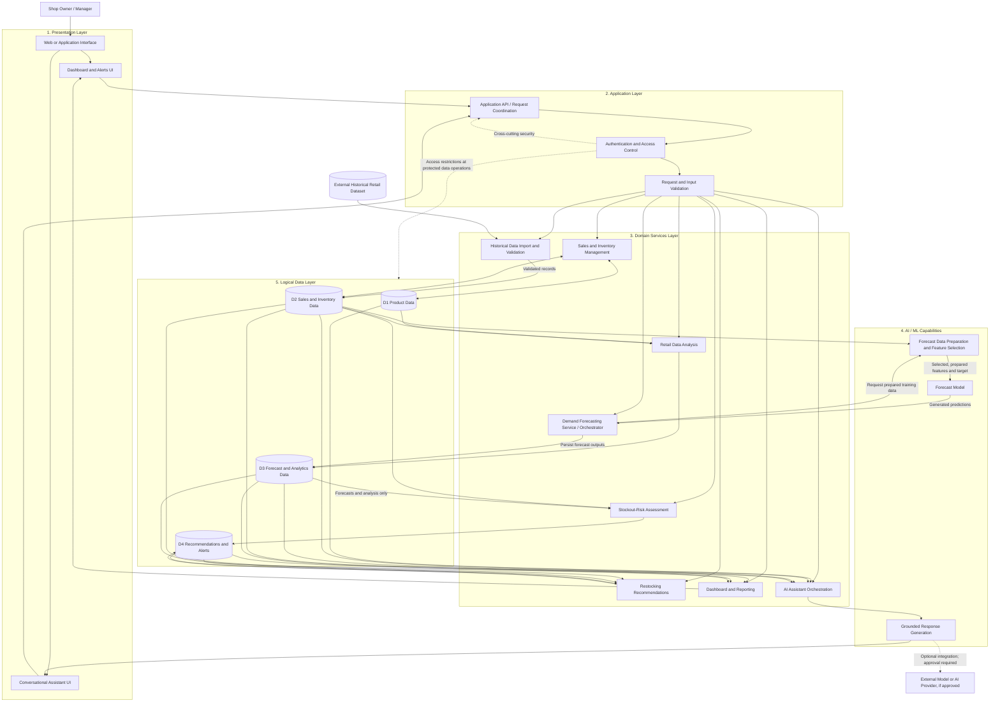

# M06-01 — Retail-X-AI Logical System Architecture

## Purpose

This diagram describes the proposed logical architecture of Retail-X-AI. It separates user-facing functionality, application coordination, domain services, AI/ML capabilities, logical data stores, and external data inputs.

The diagram is technology-neutral and describes logical interactions rather than a confirmed deployment or technology stack.

## Architecture Diagram

## Forecasting and Data-Quality Boundaries

The initial forecasting target is `Units Sold`, as documented in M05-03. Potential leakage fields identified in the data analysis — including `Demand Forecast`, `Units Ordered`, and `Inventory Level` — must not automatically be treated as valid forecasting features. Feature selection must follow the approved data-analysis decisions.

Inventory information remains available to separate stock monitoring, stockout-risk, and restocking functions where appropriate. Excluding a field from model features does not prohibit its use by another system function.

Imported records must be validated and prepared before use. The selected dataset must not be assumed to contain supplier lead times or product expiry dates. Missing information must be identified rather than invented. Restocking suggestions are decision support; the shop owner or manager retains final purchasing authority.

## Security Boundary

Authentication and authorization are cross-cutting concerns. The interface is not itself a security boundary: protected services and data operations must enforce access restrictions. Imported records and user inputs must be validated, and sensitive information must not be unnecessarily exposed in logs, errors, or external AI prompts.

## Important Boundaries

This is a logical component view, not a deployment diagram. It does not specify a programming language, web framework, cloud platform, database product, model provider, network topology, or physical server arrangement.
